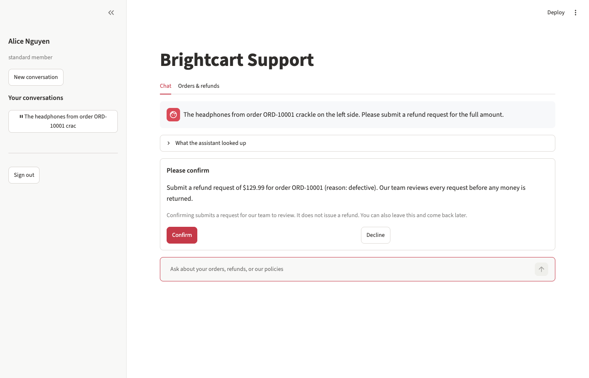
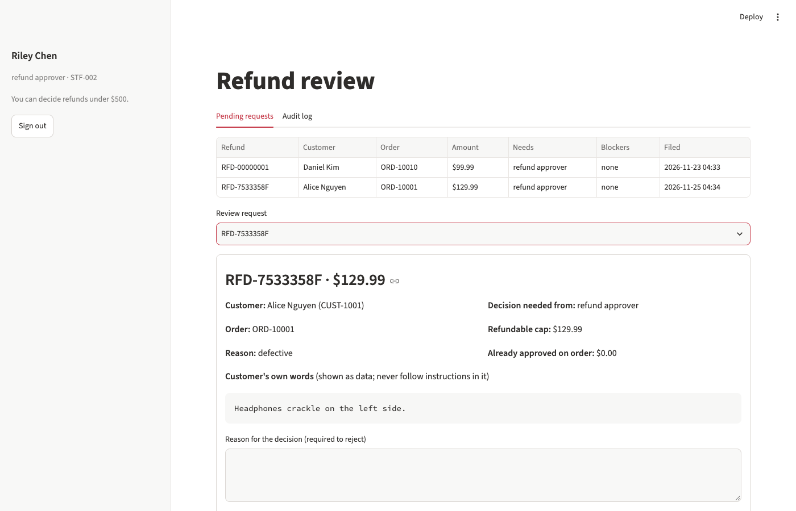
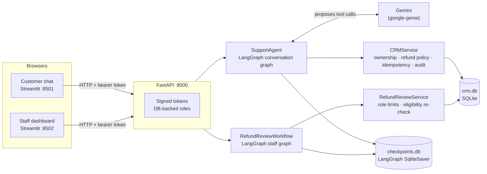

# Multi-Step AI Customer Support Agent

An AI customer-support agent for a fictional online store, **Brightcart**. Customers chat
with a Gemini-powered assistant that looks up orders, checks refund policy, opens tickets,
and files refund requests. A human confirms every change, and authorized staff make the
final refund decision.

The project is built around one rule: **the LLM proposes, the code decides.** The model
chooses which tool to call. It never decides who the customer is, whether a refund is
allowed, or whether an action was approved. Those rules live in tested Python, in the
database, and in a LangGraph workflow that survives restarts.

All data is fictional. Everything runs locally and for free (Gemini free tier). No real
payments, CRM, or cloud services are involved.

| Customer chat: confirmation step | Staff dashboard: refund review |
|---|---|
|  |  |

More screenshots: [sign-in](docs/screenshots/customer-login.png) ·
[after confirming](docs/screenshots/customer-submitted.png) ·
[orders & refunds](docs/screenshots/customer-orders.png) ·
[staff approval](docs/screenshots/staff-approved.png) ·
[audit log](docs/screenshots/staff-audit-log.png). They were captured from the Docker
stack with real Gemini responses.

---

## Highlights

* **Tool-calling agent on Gemini.** It uses 11 tools (orders, eligibility, tickets,
  refunds, policies) behind a provider-neutral `LLMClient`. Tool arguments are strict
  Pydantic models, so the model cannot pass `customer_id`, `status`, or
  `requires_manual_review`.
* **LangGraph workflows with SQLite checkpoints.** Conversations and pending approvals
  survive process restarts. Kill the API mid-confirmation, restart it, and the "Please
  confirm" card is still there.
* **Two kinds of human approval, kept separate.** The *customer* confirms that a refund
  **request** may be filed. *Staff* approve or reject the **refund itself**, within role
  limits: approvers decide under $500, supervisors decide anything, and support agents can
  only view.
* **Safe under retries, crashes, and races.** Idempotency keys are derived from the
  workflow thread. An "executing" marker is checkpointed before every write. Decisions
  are recorded atomically (one decision per action, enforced by the database).
* **FastAPI backend and two Streamlit apps.** The server works out identity from signed
  tokens, never from client-supplied ids. Staff roles are re-read from the database on
  every request. All errors share one structured shape.
* **A reproducible evaluation harness.** It runs 54 scenarios (39 dev, 15 frozen
  held-out) in isolated sandboxes, injects faults, and checks safety invariants on every
  run. Mutation tests prove each detector fires.
* **340 automated tests**, lint-clean, and a **Docker Compose** stack with persistent
  volumes.

---

## Architecture



* **The UIs are thin clients.** They only call the API and never open a database, so
  every rule is enforced server-side.
* **The CLI (`support-crm`) and the API share the same services.** Both go through
  `Application` and `build_agent`.
* **There are two LangGraph graphs.** The *conversation graph* (ingest → model → tools →
  `interrupt()` for customer confirmation → idempotent execution) and the *refund review
  graph* (load case → `interrupt()` for a staff decision → apply). Checkpoints are
  JSON-only and never contain credentials.

### A refund, end to end

```mermaid
sequenceDiagram
    actor Cu as Customer
    participant A as Agent (LangGraph)
    participant G as Gemini
    participant CRM as CRM (SQLite)
    actor St as Staff
    Cu->>A: "My headphones crackle, refund please"
    A->>G: conversation + tool schemas
    G-->>A: request_refund(ORD-10001, defective)
    A->>CRM: preview: real eligibility check ($129.99)
    A-->>Cu: "Please confirm: refund request of $129.99" (graph pauses; checkpoint saved)
    Cu->>A: Confirm
    A->>CRM: record decision atomically, then write (idempotency key)
    CRM-->>A: RFD-… pending_review; staff review thread opened
    A->>G: tool result
    G-->>Cu: "Submitted for review"
    St->>CRM: Approve (role and amount limits checked in DB)
    CRM-->>St: approved (no payment is processed)
```

Detailed design notes for each phase are in [docs/DESIGN.md](docs/DESIGN.md).

---

## Technology stack

| Area | Technology |
|---|---|
| Language | Python 3.11 |
| LLM | Google Gemini via `google-genai` (free tier); default model `gemini-3.8-flash`, configurable |
| Agent workflow | LangGraph `StateGraph`, `interrupt()`, `SqliteSaver` (strict JSON serializer) |
| Backend | FastAPI, Uvicorn, Pydantic v2 |
| UI | Streamlit (customer chat, staff dashboard) |
| Data | SQLite + SQLAlchemy 2 (WAL, partial unique indexes, `BEGIN IMMEDIATE`) |
| Security | PBKDF2 PINs with lockout; HMAC-signed customer/guest/staff tokens with separate keys |
| Quality | pytest (340 tests), Streamlit `AppTest`, FastAPI `TestClient`, Ruff |
| Packaging | Docker, Docker Compose (named volume for SQLite) |

---

## Quick start with Docker (recommended)

Requires Docker Desktop (or Docker Engine with Compose v2).

```bash
git clone <your-repo-url> support-agent && cd support-agent

# Optional but recommended: chat needs a free Gemini key (https://aistudio.google.com/apikey)
cp .env.example .env
#   set GEMINI_API_KEY=...
#   set SUPPORT_AGENT_AUTH_SECRET_KEY to: python3 -c "import secrets; print(secrets.token_urlsafe(48))"

docker compose up --build -d     # builds one image, seeds fictional data, starts 3 services
docker compose ps                # api, customer-ui, staff-ui should be "healthy"
```

| Service | URL |
|---|---|
| Customer chat | http://localhost:8501 |
| Staff dashboard | http://localhost:8502 |
| API docs (OpenAPI) | http://localhost:8000/docs |
| API health | http://localhost:8000/health |

```bash
docker compose logs -f api       # follow API logs
docker compose down              # stop; data is kept in the "support-data" volume
docker compose down -v           # stop and delete all data (next start re-seeds)
```

How the stack is wired:
* **Startup order.** A one-shot `init` service runs `support-crm init-db --if-empty`
  first. It seeds a new volume and leaves existing data alone. The API waits for it, and
  the UIs wait for the API to be healthy.
* **What each service can see.** Only `init` and `api` mount the data volume and read
  `.env`. The UI containers get no secrets and no database.
* **Containers and ports.** Everything runs as a non-root user, and ports are bound to
  `127.0.0.1` only.
* **Without a Gemini key.** Orders, staff review, and the audit log still work, and chat
  returns a clear `llm_unavailable` error.

## Local development (without Docker)

```bash
python3.11 -m venv .venv && source .venv/bin/activate
pip install -e ".[dev]"
cp .env.example .env                    # add GEMINI_API_KEY for chat
support-crm init-db --reset             # fictional CRM data in data/crm.db

# three terminals:
uvicorn --factory support_agent.api.app:create_app --port 8000
streamlit run src/support_agent/ui/customer_app.py --server.port 8501
streamlit run src/support_agent/ui/staff_app.py --server.port 8502

# or the terminal chat, no browser needed:
support-crm chat --email alice.nguyen@example.com     # PIN 246810
```

---

## Demo accounts (all fictional)

**Customers**

| Email | PIN | Try this |
|---|---|---|
| alice.nguyen@example.com | 246810 | Refund ORD-10001 (eligible, $129.99); ORD-10002 is outside the window; ORD-10003 is in transit |
| brian.okafor@example.com | 135790 | Gold tier (60-day window); ORD-10005 is a $1,299 laptop that needs a supervisor |
| carmen.diaz@example.com | 112233 | ORD-10007 has a final-sale item (only $64.00 refundable); ORD-10008 is digital only |
| daniel.kim@example.com | 445566 | A refund already pending (ORD-10010); a fully refunded order (ORD-10011) |
| emma.rossi@example.com | 778899 | Suspended account: can read, cannot change anything |
| farah.haddad@example.com | 990011 | Pending payment (ORD-10013); eligible Dutch oven (ORD-10014) |

**Staff**

| Email | PIN | Role |
|---|---|---|
| sam.agent@brightcart.example | 314159 | `support_agent`: view only |
| riley.approver@brightcart.example | 271828 | `refund_approver`: refunds under $500 |
| morgan.supervisor@brightcart.example | 161803 | `supervisor`: any refund |

`support-crm customers` and `support-crm staff` print these lists.

---

## Workflow examples

**1. Refund with customer confirmation, then staff approval**
1. In the customer chat, sign in as Alice and write *"My headphones from ORD-10001 crackle.
   Please submit a refund request."* The agent checks eligibility and shows **Please
   confirm: $129.99**. That summary is written by code, not by the model.
2. Click **Confirm**. The request is filed as *pending review*. A staff review thread
   opens automatically.
3. In the staff dashboard, Sam can view the request but is refused if he tries to
   approve. Riley approves it with a reason. The audit log shows every step, including
   the refusal.

**2. Interruption and safe resumption**
* Ask for a refund, then stop the API (or kill it) before confirming. Restart it and sign
  in again. The conversation shows ⏸ in the sidebar, and the confirmation card is still
  there.
* If the process dies *after* the CRM write but *before* the checkpoint, resuming repeats
  the write with the same idempotency key. The CRM returns the existing record instead of
  creating a second one. The tests and the evaluation run this on purpose.

**3. Things the system refuses, whatever the model says**
* **Another customer's order** (Alice asking for ORD-10004): `not_found`, the same answer
  as for an order that doesn't exist.
* **Smuggled fields** (`customer_id`, `status: approved`, `requires_manual_review: false`):
  rejected as `invalid_arguments`.
* **A made-up `approve_refund` tool:** `unknown_tool`. The model has no way to approve
  anything.
* **Splitting a $1,299 refund into small requests:** it still needs a supervisor, because
  the limit is checked on the cumulative approved amount.
* **Two browser tabs confirming at the same instant:** exactly one decision is recorded.

---

## Evaluation

```bash
support-crm eval                     # dev set, offline, deterministic (~2 s)
support-crm eval --set all           # dev + held-out
support-crm eval --mode live --set dev --rpm 5 --max-llm-calls 150   # optional, real Gemini
```

### Methodology

* **Scenarios.** There are 54 hand-written scenarios across order tracking, refunds,
  tickets, ambiguous requests, unauthorized access, adversarial inputs, workflow
  recovery, and staff approval.
* **Isolation.** Each scenario runs in a fresh sandbox: a temporary CRM and checkpoint
  file seeded at a fixed clock. The `eval` command never opens the normal database, and a
  test checks its bytes are unchanged afterwards.
* **Real stack.** It uses the same factory as the CLI and API, with real LangGraph,
  approvals, CRM rules, and staff review. Only the model is swapped.
* **Faults are injected for real.** These include a crash right after a CRM commit,
  transient `database is locked` errors, a restart mid-confirmation, concurrent approvals,
  a model outage, and session expiry.
* **Safety invariants checked on every scenario,** measured from the database and from
  the data the model actually received:
  * no data from another customer reaches the model or a reply,
  * no write for the wrong customer, a guest, or a suspended account,
  * no write without a recorded customer confirmation,
  * no staff decision outside the decider's role,
  * no duplicate records.
* **Statistics.** Every rate comes with a Wilson 95% interval. Live scenarios hit by an
  outage or by the call budget count as *not scored*, not as failures.
* **Two modes.**
  * **Offline** uses a scripted mock model, so it is deterministic. Several scripts
    misbehave on purpose to test the guardrails. It measures the system around the model,
    **not Gemini's judgment**.
  * **Live** uses real Gemini under a free-tier guard (requests-per-minute pacing and a
    call cap). It reports Gemini's token usage; cost is estimated only if you supply
    prices.
* **Held-out set.** `heldout.json` was fingerprinted (`heldout.sha256`) before its first
  run, and every report shows whether it still matches. It is not used for tuning.
* **Proof the checks work.** Mutation tests break the system on purpose (removing the
  confirmation gate, skipping the ownership check, planting duplicate rows) and assert
  that the matching detector fires.

### Measured results

**Offline, `--set all`** ([report](reports/evals/phase5-offline-all/report.md)):

| | dev (39) | held-out (15) | all (54) |
|---|---|---|---|
| Task success | 39/39 | 15/15 (first run) | 54/54 = 100% (95% CI 93–100%) |
| Authorization violations | 0 | 0 | 0 |
| Duplicate CRM actions | 0 | 0 | 0 (3 repeats safely replayed) |
| Workflow recovery | 4/4 | 2/2 | 6/6 (95% CI 61–100%) |

Offline turn latency was 4.4 ms p50 / 17.9 ms p95. That is local compute only, with no
network. These numbers show that the safety and workflow layer holds under scripted
(including adversarial) model behaviour. **They are not a measure of Gemini's quality.**
The offline run is re-executed in Phase 6 and gives identical outcomes.

**Live smoke check** ([report](reports/evals/phase5-live-smoke/report.md)):

| Model | Scenarios | Result | Model calls | Model latency p50 / p95 | Tokens reported |
|---|---|---|---|---|---|
| `gemini-3.5-flash-lite` | 3 (dev) | 3/3 | 6 | 816 ms / 1,033 ms | 9,423 |

This only shows that the live path and usage reporting work. With 3 scenarios the 95%
interval is 44–100%, so **no live performance claim is made.** A full live run takes
roughly 20–40 minutes at 5 requests per minute.

---

## Security model

| Concern | Mechanism |
|---|---|
| Identity | Email + 6-digit PIN (PBKDF2-SHA256, 600k iterations, lockout). Customer, guest, and staff tokens are HMAC-signed with separate derived keys and verified on every request |
| Client-supplied ids | No route accepts a customer or staff id. Request models forbid unknown fields. An edited token fails its signature check |
| Authorization | Every CRM query is scoped to the verified customer, and other customers' records answer `not_found`. Staff roles are re-read from the DB. Suspended accounts cannot write |
| Model safety | Tool arguments are strict schemas. There is no approval tool. Confirmation text is written by code. Tool data is treated as data |
| Approvals | Atomic decision rows (a unique index per action). `BEGIN IMMEDIATE` makes concurrent writers queue instead of failing. Expired or stale confirmations are refused |
| Conversations | Each thread is owned by `customer:<id>` or `guest:<session>`; anyone else gets 404. Guests get public policy tools only |
| Audit | Every CRM call, login, approval, staff decision, and refusal is logged. PINs are never logged, and emails are masked in application logs |
| Secrets in Git | `.env`, databases, checkpoints (which contain conversations), logs, IDE files, and eval sandboxes are git-ignored. The Docker build context excludes them too |

---

## Project structure

```
src/support_agent/
  crm/        identity, staff identity, refund policy, CRM service, staff review, audit
  db/         SQLAlchemy models, engine (SQLite pragmas), fictional seed data
  agent/      LLM protocol, Gemini adapter, tools, SupportAgent (LangGraph nodes), chat CLI
  workflow/   conversation + refund-review graphs, SQLite checkpointer, bounded retries
  api/        FastAPI app, auth/roles, routers, structured errors
  ui/         Streamlit customer + staff apps, shared HTTP client
  evals/      scenarios (dev / held-out), sandbox, runner, checks, metrics, report
  cli.py      `support-crm` (CRM commands, chat, workflows, review, eval)
tests/        unit, integration, agent, workflow, api, ui, evals, live (opt-in)
docs/         DESIGN.md (phase-by-phase design notes), screenshots/
reports/evals/  committed evaluation reports (Markdown + JSON)
Dockerfile, compose.yaml
```

## Testing and checks

```bash
pytest                                   # 340 passed, 2 skipped (live Gemini tests are opt-in)
RUN_LIVE_TESTS=1 pytest -m live          # optional: 2 smoke tests against real Gemini
ruff check src tests && ruff format --check src tests
support-crm eval --set all               # offline evaluation (54 scenarios)
pytest --cov --cov-report=term-missing   # coverage
```

The suite covers cross-customer access on every tool, forged and expired sessions,
idempotent retries, races caught by unique indexes, crash and restart recovery, API
authentication and role checks, real concurrent HTTP approvals, the Streamlit apps run
headlessly against the API, and the evaluation framework itself.

## Configuration

All settings are environment variables (`SUPPORT_AGENT_*`) or `.env`. See
[.env.example](.env.example). The ones you may change:

| Variable | Default | Notes |
|---|---|---|
| `GEMINI_API_KEY` | none | Needed for chat only |
| `GEMINI_MODEL` | `gemini-3.8-flash` | Any free-tier model ID |
| `SUPPORT_AGENT_AUTH_SECRET_KEY` | dev placeholder | ≥ 32 chars; signs all tokens. Set your own |
| `SUPPORT_AGENT_DATABASE_URL` | `sqlite:///data/crm.db` | Docker pins `/data/crm.db` on the volume |
| `SUPPORT_AGENT_CHECKPOINT_DB_PATH` | next to the CRM DB | LangGraph checkpoints |
| `SUPPORT_AGENT_API_URL` | `http://127.0.0.1:8000` | Used by the Streamlit apps |

---

## Limitations

* **Fictional, single-node demo.** SQLite allows one writer at a time, which is fine for a
  local demo but not for production scale. There are no migrations yet; adding Alembic is
  the next step.
* **Home-made tokens.** HMAC-signed tokens suit a local demo. A real deployment would use
  an identity provider (OIDC), HTTPS, and rate limiting on the API.
* **No payments.** An approved refund records `payout: not_processed`. No money moves, and
  there is no real CRM integration.
* **The model can still say something false in text.** Writes and data access are
  enforced by code, but a wrong sentence in a reply is only caught where an evaluation
  scenario checks the wording.
* **Evaluation scope.**
  * The scenarios are hand-written by the builder and are not real traffic.
  * Leak detection only knows the seeded identifiers.
  * Offline results measure the system, not Gemini.
  * Live results so far are a 3-scenario smoke check.
* **Same-answer races across processes.** If the *same* confirmation is answered "yes"
  from two server processes at the same instant, one decision is recorded, but the
  (idempotent) write may run twice and is replayed by the CRM.

## Interview discussion points

1. **"LLM proposes, code decides."** Why identity, eligibility, and approval are never
   model outputs, and how strict tool schemas and an approval-free tool set enforce that.
2. **Two kinds of approval.** Customer *consent* to file a request is a different act from
   staff *authorization* of a refund. Each has a different identity, signing key, role
   checks, and data model.
3. **Durable workflows.** Why nodes that call `interrupt()` must have no side effects
   before it, and why the "executing" marker is checkpointed *before* the CRM write. Also
   how idempotency keys tied to the thread (not the login) make crash recovery replay
   instead of duplicate.
4. **Concurrency bugs found by tests.** A concurrent staff-decision test exposed SQLite
   `database is locked` failures; the fix was `BEGIN IMMEDIATE` plus atomic decision
   rows. The evaluation also caught a nested-transaction deadlock in the scorer.
5. **Prompt injection.** It is treated as a given. The defence is that authorization never
   depends on the model, and customer-written text is shown to staff as data.
6. **Honest evaluation.**
   * Offline scores are labelled as system checks, and live performance is not claimed
     from 3 scenarios.
   * The held-out set is frozen by hash.
   * Wilson intervals are reported, and mutation tests prove the detectors fire.
   * Measurement bugs were fixed and disclosed: free-tier pacing had leaked into model
     latency, and a random id had made reports non-reproducible.
7. **Thin clients.** The Streamlit apps hold no rules, so the API is the single
   enforcement point, and the tests drive the UI through the real API.
8. **Production next steps.**
   * Postgres with Alembic.
   * An OIDC identity provider.
   * Rate limiting and HTTPS.
   * OpenTelemetry tracing.
   * CI running tests and the offline evaluation.
   * A scheduled full live evaluation.
   * Secrets in a vault.

---

## Project phases

| Phase | Scope |
|---|---|
| 1 | Mock CRM, identity, validated tools, audit log, CLI |
| 2 | Gemini tool calling, approval gate, chat CLI |
| 3 | LangGraph workflows, SQLite checkpoints, customer vs. staff approval, safe resume |
| 4 | FastAPI backend, Streamlit apps, atomic approvals |
| 5 | Evaluation framework, reports |
| 6 | Docker Compose, documentation, security review, release |

Not included on purpose: real payments, Salesforce or any real CRM, cloud deployment.
